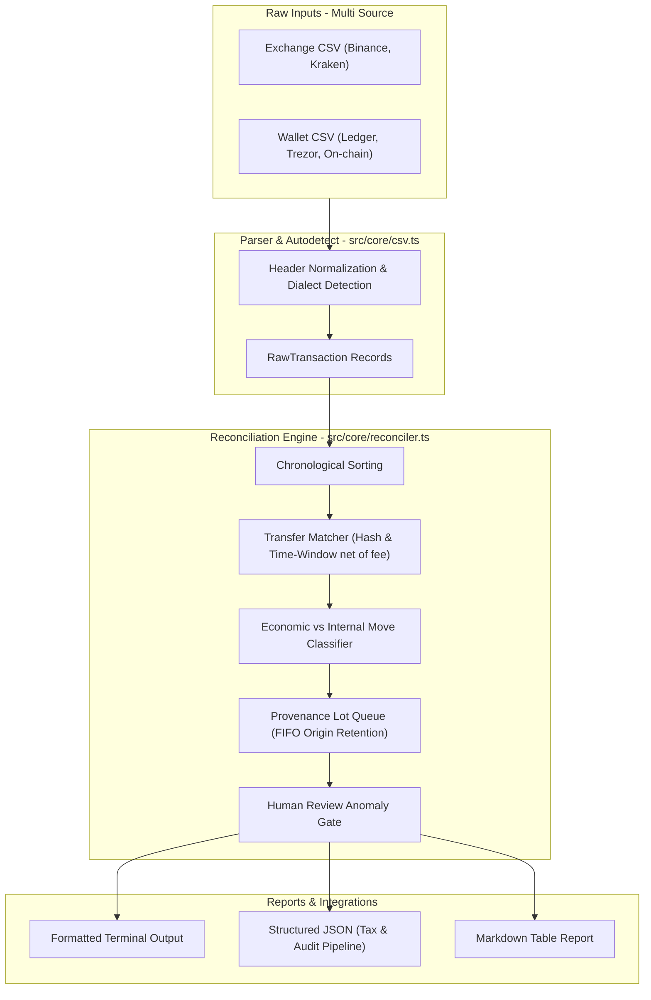

# Architecture — CryptoLedger

CryptoLedger is designed as a local-first, zero-dependency engine for cryptocurrency transaction reconciliation, asset provenance tracking, and accounting classification.

## Core Modules & Boundaries

1. **`src/core/csv.ts`**:
   - Zero-dependency streaming line & quote parser.
   - Detects format schemas (Binance, Kraken, Hardware Wallets, Generic).
   - Generates normalized `RawTransaction` items.

2. **`src/core/reconciler.ts`**:
   - Identifies internal transfers between own accounts (non-taxable custody moves).
   - Accounts for network gas and withdrawal fee deductions.
   - Preserves acquisition origin chains across transfer hops using lot tracing.
   - Flags suspicious or unlinked transactions for explicit human review.

3. **`src/core/reporter.ts`**:
   - Formats outputs for terminal display, structured JSON (`ReconciliationReport`), and Markdown tables.

4. **`src/cli/index.ts`**:
   - CLI execution layer supporting file batches, time window configuration, and output redirection.

## Invariants & Design Rules

- **Zero Runtime Dependencies**: The core uses only Node.js built-in modules (`node:fs`, `node:path`, `node:process`).
- **Core Size Constraint**: The `src/core/` directory must strictly stay below 1,500 non-empty lines of code, verified in CI.
- **Read-Only / Local-First**: No outbound network calls, no telemetry, no write access to external wallets or credentials.
